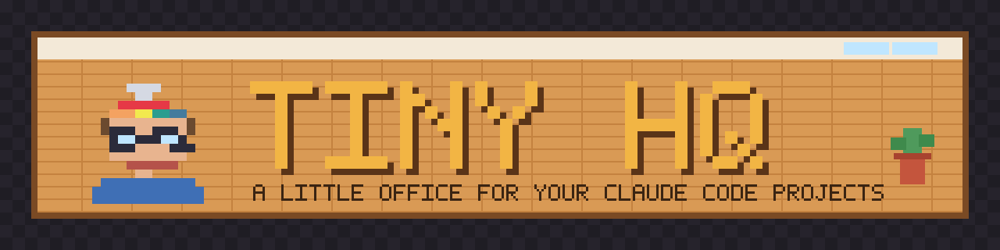
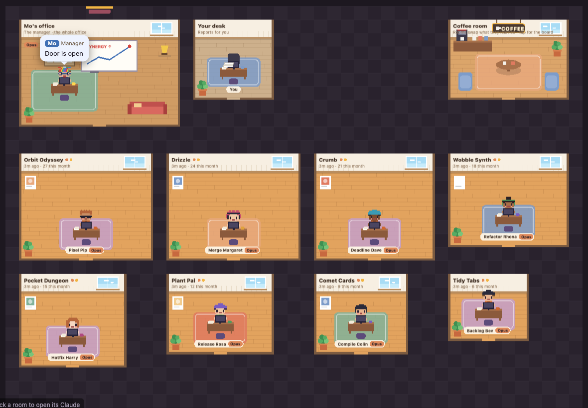
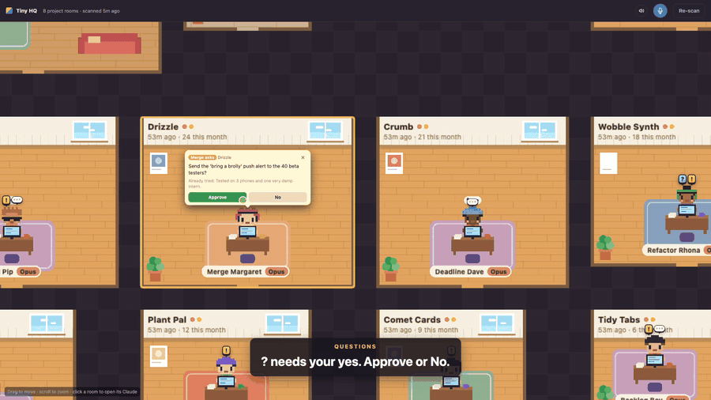

<p align="center"></p>

<p align="center">
  
  
  
  
</p>

# Tiny HQ

A little office for your Claude Code projects.

<p align="center"></p>

Every busy project gets a room, and each room is that project's own Claude Code session. A manager (also Claude, with a name and style you pick) hands out work, keeps a whiteboard, and makes sure jobs get finished. When a session needs you, a question mark appears over its head: tap it and answer with a button instead of digging through chats.

<p align="center"><a href="../../releases/latest/download/tiny-hq-tour.mp4"></a><br><a href="../../releases/latest/download/tiny-hq-tour.mp4"><b>Watch the 90-second tour</b></a></p>

It runs on your Mac, on your own Claude Code plan. There is no server of ours, no account and no API key.

## What you get

- **A room per project,** found from your Claude Code history and your project folders. Bigger rooms for busier projects; quiet ones go to the archive cupboard.
- **A manager** who hands work to the right room, writes a brief for every job, nudges rooms that go quiet, and reports back in a speech bubble.
- **Jobs that get finished.** Each job has a "done when" line; the office keeps it moving until it's true, and holds it when it's waiting on someone else.
- **Question buttons, not chat.** Every question for you is an Approve / No (or a short list of choices) over someone's head, and it must say why only you can answer and what was already tried.
- **Your desk,** where reports you asked for wait as readable pages.
- **Room goals.** Give a room a goal on the whiteboard and it takes small, private steps toward it on its own, on a branch, stopping before anything that needs you.
- **A terminal for every room** in the page, so you can step into any session.
- **Optional extras:** a GitHub keeper that watches your repos for other people's pull requests, issues and comments; a coffee room where rooms share what they learned; little office happenings; phone access over your own Tailscale network.

## Safe by default

- **No email goes out without you.** Rooms write drafts; you send.
- **Nothing goes on a public site without your yes to the exact text.** An optional hook stops any session about to comment, post or upload on GitHub, social sites or forums, and shows you the action first.
- **Outside text is never an instruction.** What the GitHub keeper and the timed checker read (other people's comments, email) reaches the manager as facts only, never as orders.
- **Nothing outside `~/.tiny-hq` without asking.** Setup has a separate switch for each Claude Code hook, the office skill and the login item, and `tiny-hq uninstall` takes them all out again.
- **Local only.** The office listens on 127.0.0.1. Phone access is off unless you set up Tailscale yourself, and then only your own devices, each paired once, can reach it.
- **The manager can't do project work.** Its folder's settings block edits in your projects and the usual shell ways of changing things; it delegates.

## Install

You need macOS, [Node](https://nodejs.org) 22.17 or newer, and [Claude Code](https://claude.com/claude-code). The GitHub CLI (`gh`) is optional, for the GitHub keeper.

```sh
npx tiny-hq-office
```

This copies the office to `~/.tiny-hq/app`, adds a `tiny-hq` command to `~/.local/bin`, and opens a welcome page in your browser. In a few short steps you:

1. name your office and tell it your name,
2. hire your manager: their name and style (calm, whimsical or plain),
3. tick which of your projects get a room,
4. switch the extras on or off,
5. choose which little helpers to add to Claude Code.

Then "Open my office" moves you in. Prefer the terminal? `tiny-hq setup --terminal` asks the same questions there.

## Everyday commands

```sh
tiny-hq open        # start the office if needed and open it
tiny-hq setup       # change your answers (the welcome page again)
tiny-hq doctor      # check the set-up and say what's missing
tiny-hq stop        # stop the office (your Claude sessions keep running)
tiny-hq pair        # a one-time link for your phone (after phone access is set up)
tiny-hq screen on   # let rooms screenshot and click desktop apps (needs `brew install peekaboo`; off: tiny-hq screen off)
tiny-hq uninstall   # take out the hooks, skill link and login items (--all also deletes ~/.tiny-hq)
npx tiny-hq-office@latest  # update
```

## Settings

Everything lives in `~/.tiny-hq/config.json` (setup writes it; you can edit it too). Besides the setup answers:

- `pinnedProjects`, `archivedProjects`, `hiddenProjects`, `extraProjects`: which folders get rooms.
- `briefingTime`: when the manager does the daily brief (`"08:30"` by default).
- `goalRooms`: how many rooms may work on their goals at once (default 1, 0 turns it off).
- `usageCommand`: optional. A command that prints your Claude usage as JSON; with it, goal work follows how much of your 5-hour and weekly allowance is left instead of `goalRooms`.

Your own extra rules for the manager go in `~/.tiny-hq/manager-rules.md`.

## How it works

The office is a small Node server and a pixel-art page (PixiJS). It reads your Claude Code and Codex history and your project folders to find projects, starts and talks to Claude Code sessions with `claude --bg`, and keeps its notes (jobs, the whiteboard, the desk, the timetable) as plain files in `~/.tiny-hq`. The manager is a Claude Code session in `~/.tiny-hq/app/manager` whose instructions are written from your settings.

## Support

Tiny HQ is free and open source (MIT). If it saves you time, you can say thanks with a tip: GitHub Sponsors / Ko-fi (links to come).

## Licence

MIT. Not affiliated with Anthropic; works with Claude Code.
